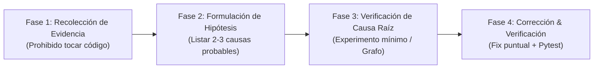

# Skill: Depuración Sistemática de Errores (`systematic-debugging`)

## 1. Propósito
Establecer un proceso estructurado de depuración en 4 fases para **Laya Service Desk**. Elimina las conjeturas, evita parches superficiales (*symptom treating*) y garantiza la identificación exacta de la causa raíz antes de modificar cualquier línea de código o configuración experimental.

---

## 2. Cuándo Activar Esta Skill
- Falla un test unitario o de integración (`pytest tests/`).
- Ocurren excepciones durante la preparación de datasets (`prepare.py`), ingestión o validación de YAML.
- Errores de tipado, parseo de datos o validación de licencias de fuentes.
- Discrepancias entre ejecución local en Docker CPU y ejecución remota en Colab Pro.
- Excepciones en pipelines de inferencia o evaluación.
- Problemas que persisten tras dos intentos fallidos de solución.

---

## 3. Protocolo de 4 Fases



---

### Fase 1: Recolección de Evidencia
> [!IMPORTANT]
> **Regla estricta:** NO modifiques ningún archivo de código ni de datos en esta fase. Solo observa, reproduce y recopila datos.

1. **Leer el Traceback Completo:** No te limites a la última línea del error. Revisa el archivo exacto, número de línea y el contexto de ejecución.
2. **Reproducir el Fallo de Forma Aislada:**
   - Para un test unitario específico:
     ```bash
     python -m pytest tests/<archivo_test.py>::<nombre_test> -v
     ```
   - Para verificación sintáctica rápida de un script:
     ```bash
     python -m py_compile <ruta/al/archivo.py>
     ```
   - Para validar un pipeline de preprocesamiento:
     ```bash
     python src/preprocessing/prepare.py --config <ruta/config.yaml> --output <ruta/salida_temporal.jsonl>
     ```
3. **Identificar Cambios Recientes:** Revisar los archivos tocados durante la sesión en `src/`, `configs/` o `tests/`.

---

### Fase 2: Formulación de Hipótesis
Formula entre **2 y 3 hipótesis concretas** ordenadas por probabilidad, respaldadas por la evidencia:

*Ejemplo de estructura:*
1. **[Más probable]** El archivo YAML de configuración tiene un nombre de columna que no coincide con el CSV de la fuente.
   - *Evidencia:* `ValueError: synthetic: columnas faltantes: ['support_group']`.
2. **[Posible]** El archivo de salida ya existe y el flag de seguridad impide sobreescribirlo.
   - *Evidencia:* `FileExistsError: No se sobrescribe: data/processed/tickets.jsonl`.
3. **[Menos probable]** Codificación de caracteres incompatible en el CSV (ej. UTF-8 con BOM o latin-1).
   - *Evidencia:* `UnicodeDecodeError` al leer las primeras líneas de la fuente.

---

### Fase 3: Verificación de la Causa Raíz (Sinergia con Graphify)
Verifica tu hipótesis principal con el experimento más pequeño posible:

1. **Consulta el Grafo de Dependencias:**
   - Si `graphify-out/graph.json` está presente, inspecciona quién llama o importa al módulo fallido:
     ```bash
     graphify query "¿Qué módulos llaman a normalize en prepare.py?"
     ```
2. **Inspección de Estado y Datos:**
   - Inspeccionar la estructura de los datos crudos con scripts mínimos o fixtures en `tmp_path`.
   - Verificar si la fuente tiene habilitado el flag `license_verified: true` y `enabled: true`.
3. **Evalúa una Sola Hipótesis a la Vez:** No cambies múltiples parámetros o archivos simultáneamente.

#### Causas Frecuentes en Laya Service Desk

| Síntoma | Causa Más Probable | Comprobación / Verificación |
| :--- | :--- | :--- |
| `ValueError: ... columnas faltantes` | `column_map` en el YAML no coincide con los headers del CSV. | Inspeccionar la primera fila del CSV de la fuente y contrastarla con el YAML. |
| `ValueError: Licencia no verificada` | La fuente no tiene `license_verified: true` en la configuración. | Revisar `configs/` y la documentación de licencias en `docs/03_DATASETS_Y_LICENCIAS.md`. |
| `ValueError: No hay fuentes habilitadas` | Todas las fuentes en el config tienen `enabled: false`. | Verificar que al menos una fuente válida tenga `enabled: true`. |
| `FileExistsError: No se sobrescribe` | El archivo de salida ya existe en disco. | Limpiar o cambiar la ruta de salida para evitar corrupción accidental de datasets procesados. |
| `NotImplementedError` en train/benchmark | Intento de ejecutar un placeholder antes de validar los gates G0-G3. | Verificar `docs/12_PROTOCOLO_EXPERIMENTAL.md` antes de implementar el módulo. |
| `ModuleNotFoundError: No module named 'src'` | `PYTHONPATH` no incluye la raíz del proyecto. | Ejecutar como módulo: `python -m pytest` o `python -m src.preprocessing.prepare`. |
| `AssertionError` en tests de normalización | Espacios en blanco adicionales o normalización incompleta. | Comprobar `' '.join(texto.split())` y caracteres no imprimibles. |

---

### Fase 4: Corrección Mínima y Verificación
Una vez aislada con certeza la causa raíz:

1. **Aplica únicamente la corrección necesaria:** No toques código adyacente ni intentes "refactorizaciones oportunistas".
2. **Ejecuta el test que fallaba:** Debe pasar al 100%.
3. **Ejecuta la suite completa del proyecto:**
   ```bash
   python -m pytest -q
   ```
4. **Registra la justificación técnica:** Si la corrección involucra una decisión sobre el protocolo experimental, añade el comentario `# DECISIÓN EXPERIMENTAL:` correspondiente.

---

## 4. Reglas de Escalamiento y Anti-Patrones

### Anti-Patrones a Evitar:
- ❌ **Shotgun Debugging:** Cambiar 5 cosas al azar en el código o en los configs esperando que funcione.
- ❌ **Tratamiento de Síntomas:** Agregar un `except Exception: pass` para saltar registros corruptos en lugar de auditar el dataset.
- ❌ **Asumir sin reproducir:** "Creo que el CSV está roto". Primero reprodúcelo con un test aislado.
- ❌ **Simular resultados:** Crear métricas ficticias o inventar datos para superar un error.

### Reglas de Escalamiento:
- **Tras 3 intentos fallidos:** Detén los cambios. La hipótesis es incorrecta. Vuelve a la Fase 1 y revisa los datos crudos.
- **Tras 5 intentos fallidos:** Cuestiona los supuestos del experimento o de la API del modelo. Revisa `docs/` o consulta al usuario antes de continuar.
