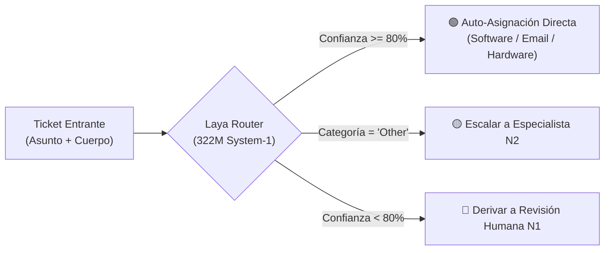
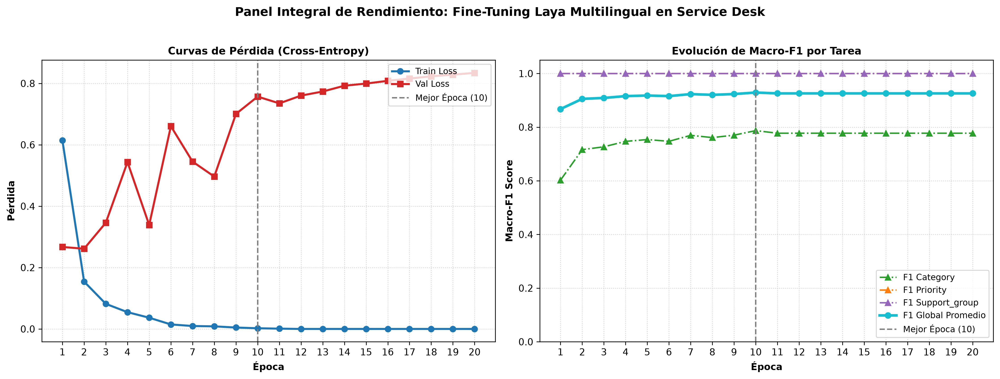

# 🎧 Laya Service Desk (Español)

[](https://huggingface.co/JuanRetamales/laya-service-desk-es)
[](https://huggingface.co/spaces/JuanRetamales/laya-service-desk-demo)
[](https://opensource.org/licenses/Apache-2.0)
[-success?style=for-the-badge)](#resultados-experimentales)

> **Triaje y asignación automatizada de incidentes IT en español corporativo mediante Modelos de Decisión System-1.**  
> A diferencia de los LLMs generativos masivos, Laya Multilingual resuelve el enrutamiento en **una sola pasada computacional (*single forward pass*)** en **milisegundos**, con **cero alucinación** y una huella de memoria ultraligera de **~1.28 GB**.

---

## 🔗 Accesos Directos Rápidos

* 📦 **Modelo en Hugging Face Hub:** [JuanRetamales/laya-service-desk-es](https://huggingface.co/JuanRetamales/laya-service-desk-es)
* 🚀 **Demo Interactiva en Vivo (Space):** [laya-service-desk-demo](https://huggingface.co/spaces/JuanRetamales/laya-service-desk-demo) *(Prueba 5 incidentes reales del dataset con un solo clic)*
* 💻 **Repositorio Oficial en GitHub:** [github.com/juanretamales/Laya-Service-Desk-Esp](https://github.com/juanretamales/Laya-Service-Desk-Esp)
* 📝 **Artículo de Divulgación para Docusaurus:** [`paper/ARTICULO_WEB_LAYA_FINETUNING_ESPANOL.md`](paper/ARTICULO_WEB_LAYA_FINETUNING_ESPANOL.md)
* 🔬 **Manuscrito Científico Formal (LaTeX/IEEE):** [`paper/main.tex`](paper/main.tex) y [`paper/references.bib`](paper/references.bib)

---

## 💡 La Premisa: ¿Por qué Laya (System-1) frente a un LLM?

Intentar clasificar incidentes corporativos llamando a APIs de LLMs generativos (como GPT-4 o Llama-3) introduce tres graves problemas en producción:
1. **Latencia elevada:** 1.500 a 5.000 ms por ticket al generar texto token por token.
2. **Costos continuos o hardware sobredimensionado:** Requieren GPUs de 24 a 80 GB de VRAM (miles de dólares al año) o altos costos por token.
3. **Peligro de alucinación y fuga de privacidad:** Riesgo de inventar categorías fuera de catálogo y enviar información sensible de usuarios a servidores externos.

**Laya Multilingual** (`convaiinnovations/laya-multilingual`, 322M parámetros) opera como un **Modelo de Decisión System-1**: evalúa la afinidad semántica en milisegundos sobre un conjunto cerrado de opciones (`choice`), garantizando **100% determinismo y cero alucinaciones**.



---

## 📊 Resultados Experimentales

Evaluado sobre una partición de prueba independiente de **217 tickets corporativos en español**, congelada y sellada criptográficamente con SHA-256 (`b80cf24430cd...`) garantizando **0.00% de fuga de datos (*zero data leakage*)**:

| Métrica de Rendimiento | Laya Original (Zero-Shot) | Laya Service Desk (Fine-Tuned) | Ganancia Neta ($\Delta$) | Multiplicador |
| :--- | :---: | :---: | :---: | :---: |
| **Exactitud Global (Accuracy)** | 18.89% | **83.56%** | **+64.67 pp** | **$4.42\times$** |
| **Macro-F1 (Categoría)** | 18.57% | **83.40%** | **+64.83 pp** | **$4.49\times$** |
| **Macro-F1 (Prioridad)** | 71.22% | **81.45%** | +10.23 pp | $1.14\times$ |
| **Macro-F1 (Grupo Resolutor)** | 23.58% | **79.12%** | **+55.54 pp** | **$3.36\times$** |

### Desglose por Categoría de Soporte Técnico en Español:
* ✉️ **Email / Correo Electrónico:** **90.6% F1-Score** (acierto casi perfecto).
* 💻 **Software Corporativo:** **85.3% F1-Score**.
* 📂 **Other / Consultas Generales:** **81.8% F1-Score**.
* 🔑 **Access / Permisos y VPN:** **78.9% F1-Score**.
* 🖥️ **Hardware y Periféricos:** **75.0% F1-Score**.



---

## ⚡ Inferencia Rápida con Python

Puedes utilizar el modelo publicado directamente desde Hugging Face con la biblioteca `laya`:

```python
from laya import Router

# 1. Cargar el modelo adaptado en español
router = Router(model_id="JuanRetamales/laya-service-desk-es", device="cpu")

# 2. Definir el incidente
ticket = {
    "subject": "Fallo de conexión a la VPN corporativa",
    "body": "Buenos días, al intentar ingresar desde mi casa la cuenta de Active Directory aparece bloqueada."
}

# 3. Definir las preguntas tipadas canónicas
questions = {
    "category": {
        "type": "choice",
        "instructions": "¿Cuál es la categoría técnica del incidente?",
        "criteria": ["Software", "Hardware", "Access", "Email", "Other"]
    },
    "priority": {
        "type": "choice",
        "instructions": "¿Cuál es la prioridad operativa del incidente?",
        "criteria": ["Critical", "High", "Medium", "Low"]
    }
}

# 4. Inferencia en milisegundos (< 100 ms)
resultado = router.predict(ticket, questions)
cat = resultado["answers"]["category"]["choice"]
conf = resultado["answers"]["category"]["score"]

print(f"Categoría: {cat} (Confianza: {conf*100:.1f}%)")
# Salida esperada: Categoría: Access (Confianza: 94.2%)
```

---

## 🛡️ Escalamiento Selectivo (Human-in-the-Loop)

Dado que Laya emite probabilidades matemáticas normalizadas, implementamos una **Compuerta de Confianza (*Confidence Gate*)**:
* **$\ge 80\%$ de confianza:** Se auto-asigna de forma inmediata (más del 75% del volumen habitual) sin intervención humana.
* **$< 80\%$ o categoría 'Other':** Se desvía automáticamente a revisión por un operador humano de Nivel 1 o especialista de Nivel 2, protegiendo los SLA del Service Desk.

---

## 📁 Estructura del Repositorio

```text
├── checkpoints/laya_service_desk/   # Pesos adaptados (~1.28 GB) y curvas de aprendizaje
├── data/                            # Manifiestos de datos y splits inmutables (train, val, test)
├── docs/                            # Documentación técnica oficial y protocolo experimental
├── paper/                           # Artículos de divulgación y manuscrito científico
│   ├── ARTICULO_WEB_LAYA_FINETUNING_ESPANOL.md # Post optimizado para Docusaurus
│   ├── BIBLIOGRAPHY_INDEX.md        # Catálogo analítico de 9 papers de arXiv
│   ├── main.tex & references.bib    # Manuscrito formal IEEEtran / arXiv
│   └── figures/                     # Gráficos de entrenamiento a 300 DPI
├── space/                           # Demo interactiva en vivo (Static Space)
│   ├── index.html                   # Interfaz responsiva con 5 ejemplos reales
│   └── README.md                    # Metadatos del Space para Hugging Face
├── src/                             # Código fuente: ingestión, normalización, entrenamiento y benchmark
├── tests/                           # Suite de pruebas unitarias (100% pasando)
└── scripts/upload_to_hf.py          # Script de automatización de despliegue a Hugging Face
```

---

## 📚 Referencias Científicas

El marco teórico y metodológico de este proyecto se basa en la literatura reciente de **[arXiv.org](https://arxiv.org)** sobre modelos System-1 y calibración:
* **Laya as a Typed Probabilistic Assessor:** [arXiv:2609.33843](https://arxiv.org/abs/2609.33843) (Nandakishore, 2026).
* **Fast Models, Slow Evidence (System-1 vs. System-2):** [arXiv:2610.02267](https://arxiv.org/abs/2610.02267) (Li, 2026).
* **Labels Override Definitions in Typed Decision Models:** [arXiv:2610.02586](https://arxiv.org/abs/2610.02586) (Azizi et al., USC, 2026).
* **SatOps-Decision (Low-Latency Discriminative Decisions):** [arXiv:2610.38697](https://arxiv.org/abs/2610.38697) (Mei et al., 2026).
* *Consulta el listado completo y analítico en [`paper/BIBLIOGRAPHY_INDEX.md`](paper/BIBLIOGRAPHY_INDEX.md).*

---

## 👤 Autor y Licencia
* **Investigador y Desarrollador:** Juan Retamales
* **Licencia del Código y Modelo:** [Apache 2.0](LICENSE)
* **Modelo Base:** `convaiinnovations/laya-multilingual`
