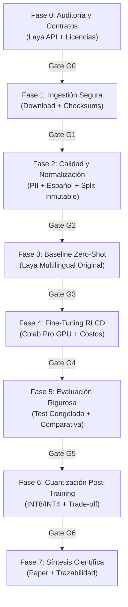

# Roadmap Granular para Agente IA — Laya Service Desk

Este documento desglosa el protocolo científico y técnico del laboratorio en subtareas verificables. Cada fase cuenta con **criterios de salida obligatorios (Exit Gates)**, niveles de impacto operativo y artefactos asociados.

> [!IMPORTANT]
> **Políticas Operativas del Agente:**
> 1. **Clasificación de Operaciones:** Distinguir antes de actuar entre `[Solo Lectura]`, `[Reversible]` (código local, tests, configs) y `[Requiere Autorización]` (descargas masivas, GPU/Colab, operaciones externas o Git).
> 2. **Archivos Temporales:** Todo borrador, plan efímero o script de prueba debe alojarse en `tmp/`. La carpeta `docs/` se reserva para documentación técnica formal y persistente.
> 3. **Prohibición de Simulación:** No inventar métricas, baselines ni compatibilidades. Todo placeholder debe fallar con `NotImplementedError` hasta cumplir sus gates.
> 4. **No Git Commands:** No ejecutar comandos Git directamente.

---

## 🧭 Resumen de Fases y Gates

---

## 📌 Desglose Detallado por Fases

### Fase 0: Verificación de Contratos, Modelo Laya y Licencias (Gate G0)
*Objetivo:* Auditar el repositorio oficial del modelo, dependencias y restricciones legales antes de procesar datos o código de entrenamiento.

- [x] **0.1 Auditoría del Repositorio Laya `[Solo Lectura]`:**
  - Validar repositorio oficial: [NandhaKishorM/laya](https://github.com/NandhaKishorM/laya).
  - Validar checkpoint para español: `convaiinnovations/laya-multilingual` (322M, mmBERT-base, 1024–8192 tokens).
  - Verificar licencia: Apache 2.0. Registrar en [`configs/model.yaml`](configs/model.yaml).
- [x] **0.2 Verificación de la API y Paradigma de Inferencia `[Solo Lectura]`:**
  - Auditar API `Router`: preguntas tipadas (`choice`, `score`, `noul`) en una sola pasada hacia adelante (*single forward pass*).
  - Verificar compatibilidad de clasificación multiclase para `category`, `priority` y `support_group`.
- [x] **0.3 Auditoría de Licencias de Datasets Candidatos `[Solo Lectura]`:**
  - Auditar fuentes de [`docs/03_DATASETS_Y_LICENCIAS.md`](docs/03_DATASETS_Y_LICENCIAS.md) (Kaggle Multilingual, Zenodo 7648117, Mendeley Helpdesk, MDPI).
  - Verificar permisos expresos de redistribución e investigación comercial/académica. Excluir fuentes sin licencia verificada.
- [x] **0.4 Matriz de Riesgos y Restricciones `[Reversible]`:**
  - Documentar riesgos de sesgo lingüístico, PII, balance de clases y disponibilidad de GPU en Colab Pro.

> **Exit Gate G0 (SUPERADO):** Checkpoints de Laya y licencias de datos auditadas y registradas con confirmación formal en `configs/model.yaml` y `docs/PROGRESS.md`.

---

### Fase 1: Ingestión, Descarga Segura y Manifiestos de Datos (Gate G1)
*Objetivo:* Implementar herramientas reproducibles para descargar las fuentes aprobadas sin depender de contenedores ni intervenciones manuales desordenadas.

- [x] **1.1 Implementar Módulo de Descarga (`src/ingestion/download.py`) `[Reversible]`:**
  - Soporte para descarga HTTP y API REST pública (Zenodo record 7648117, etc.) mediante librería estándar (`urllib.request`).
  - Validación de integridad automática: cómputo y verificación de hashes SHA-256 de los archivos descargados.
  - Descompresión automática controlada (ZIP / TAR) hacia `data/raw/<source_id>/`.
  - Salvaguarda e idempotencia: omite descargas si el archivo ya existe y es íntegro (vital para Colab).
- [x] **1.2 Generador de Manifiesto Inmutable (`data/raw/manifest.json`) `[Reversible]`:**
  - Registrar para cada archivo descargado: `source_id`, URL de origen, timestamp UTC, tamaño en bytes y hash SHA-256.
- [x] **1.3 Fixtures Sintéticos para Pruebas Aisladas `[Reversible]`:**
  - Crear datos sintéticos mínimos de prueba en `tests/fixtures/synthetic_tickets.csv` para validar el pipeline sin requerir descargas pesadas de internet.
- [x] **1.4 Tests Unitarios de Ingestión (`tests/test_download.py`) `[Reversible]`:**
  - Validar manejo de errores de conexión, corrupción de hash SHA-256, parseo e idempotencia de descargas (12/12 tests pasando).

> **Exit Gate G1 (SUPERADO):** Módulo de descarga probado con fixtures sintéticos, hash SHA-256 validado, datos reales de Zenodo en `data/raw/zenodo_tickets/` y manifiesto estructurado en `data/raw/manifest.json`.

---

### Fase 2: Normalización, Anonimización PII, Deduplicación y Splits (Gate G2)
*Objetivo:* Unificar datasets dispersos en un contrato canónico en español, eliminando datos sensibles y garantizando aislamiento sin fuga (*data leakage*).

- [x] **2.1 Anonimización y Sanitización de PII (`src/preprocessing/anonymize.py`) `[Reversible]`:**
  - Detección y enmascaramiento con Regex de entidades sensibles: emails (`<EMAIL>`), teléfonos (`<PHONE>`), direcciones IP (`<IP>`), tarjetas/cuentas (`<CARD>`), y nombres propios en saludos/firmas.
  - Normalización de placeholders heredados (`[NAME]`, `[COMPANY]` -> `<NAME>`, `<ORG>`).
  - Verificación mediante suite de 11 tests unitarios en `tests/test_anonymize.py`.
- [x] **2.2 Validación y Filtrado de Idioma (`src/preprocessing/language.py`) `[Reversible]`:**
  - Filtrado estricto para asegurar tickets en idioma español frente a inglés, portugués y alemán.
  - Clasificación determinista con marcadores léxicos, stopwords y ortografía distintiva.
  - Verificación mediante suite de 7 tests unitarios en `tests/test_language.py`.
- [ ] **2.3 Mapeo Canónico de Etiquetas y Vocabulario (`src/preprocessing/unify.py`) `[Reversible]`:**
  - Contrato de columnas: `ticket_id`, `subject`, `description`, `category`, `priority`, `support_group`.
  - Mapeo semántico a clases canónicas de [`docs/04_NORMALIZACION.md`](docs/04_NORMALIZACION.md):
    - *Categorías:* `access`, `network`, `hardware`, `software`, `email`, `database`, `other`, `unknown`.
    - *Prioridades:* `low`, `medium`, `high`, `critical`, `unknown`.
    - *Grupos:* `service_desk`, `identity`, `network`, `workplace`, `applications`, `dba`, `other`, `unknown`.
  - No inferir ni inventar etiquetas faltantes: marcar como `unknown`.
- [ ] **2.4 Deduplicación Exacta y Semántica `[Reversible]`:**
  - Deduplicación por hash SHA-256 de texto normalizado (`subject + description`).
  - Reporte de tasas de duplicados descartados por fuente.
- [ ] **2.5 Formateo Dual de Datos `[Reversible]`:**
  - Exportar en formato tabular `data/processed/unified_tickets.jsonl`.
  - Adaptar estructura al formato de preguntas tipadas de Laya (`state: {"subject": ..., "body": ...}`, `questions: {...}`).
- [ ] **2.6 Particionado Estratificado sin Fuga (`src/preprocessing/split.py`) `[Reversible]`:**
  - Split: 70% Train, 15% Validation, 15% Test.
  - Estratificación por `category` (o multi-etiqueta si aplica).
  - **Congelamiento de Test:** fijar hash SHA-256 de `data/splits/test.jsonl`. Queda prohibido modificarlo o consultarlo durante entrenamiento.
  - Verificación de no solapamiento (*zero leakage*): validar intersección vacía de textos entre particiones.
- [ ] **2.7 Tests Unitarios de Preprocesamiento (`tests/test_unify.py`, `tests/test_splits.py`) `[Reversible]`:**
  - Probar normalización, sanitización PII, integridad de mapeos y splits inmutables.

> **Exit Gate G2:** Dataset unificado generado en `data/processed/`, test set congelado con hash en `data/splits/` y 0% de fuga verificado por tests unitarios.

---

### Fase 3: Evaluación de Baseline Original Laya Multilingual (Gate G3)
*Objetivo:* Evaluar el desempeño zero-shot de `laya-multilingual` sin fine-tuning para establecer el punto de partida científico.

- [ ] **3.1 Implementar Harness de Evaluación (`src/evaluation/benchmark.py`) `[Reversible]`:**
  - Cargar `laya.Router(model="multilingual")`.
  - Configurar preguntas tipadas con las opciones canónicas del proyecto.
- [ ] **3.2 Inferencia Zero-Shot sobre Test Congelado `[Reversible]`:**
  - Ejecutar predicción sobre `data/splits/test.jsonl` usando inferencia local o Colab CPU/GPU.
- [ ] **3.3 Medición de Métricas Baseline `[Reversible]`:**
  - F1-macro y F1-micro para `category`, `priority` y `support_group`.
  - Accuracy general y F1 por clase individual.
  - Matriz de confusión completa por tarea.
  - Tasa de abstención (`min_confidence`) y distribución de confianza calibrada.
  - Métricas de eficiencia: latencia por ticket (p50, p95), uso de RAM/VRAM.
- [ ] **3.4 Registro Inmutable de Línea Base (`reports/baseline_results.json`) `[Reversible]`:**
  - Guardar métricas y matriz de confusión como referencia inmutable para comparación.

> **Exit Gate G3:** Baseline reproducible ejecutado sobre el test congelado; reporte JSON persistido con métricas F1 y latencia documentadas.

---

### Fase 4: Fine-Tuning de Laya en Colab Pro (Gate G4)
*Objetivo:* Ajustar el modelo Laya Multilingual sobre los tickets corporativos en español respetando el protocolo de entrenamiento RLCD.

- [ ] **4.1 Configuración de Hiperparámetros (`configs/training.yaml`) `[Reversible]`:**
  - Fijar semilla aleatoria (`seed: 42`).
  - Definir batch size, learning rate, warmup steps, weight decay y épocas.
  - Regla: Entrenar únicamente con `train.jsonl` y afinar hiperparámetros solo con `val.jsonl`.
- [ ] **4.2 Módulo de Entrenamiento (`src/training/train.py`) `[Reversible]`:**
  - Implementar pipeline de entrenamiento basado en RLCD / typed decisions tuning compatible con Laya.
  - Calibración de temperatura por tarea (`temperature_scaling`).
- [ ] **4.3 Notebook Orquestador de Colab (`notebooks/laya_finetune_service_desk.ipynb`) `[Reversible]`:**
  - Carga de código desde revisión Git/commit fijado.
  - Validación de hashes SHA-256 de `train.jsonl` y `val.jsonl`.
  - Instrumentación para registro de recursos: modelo de GPU asignada, VRAM pico, GPU-horas y tiempo total.
- [ ] **4.4 Ejecución del Entrenamiento en Colab Pro `[Requiere Autorización]`:**
  - Ejecutar entrenamiento tras autorización del usuario.
  - Monitorear pérdida de entrenamiento y convergencia en validation.
- [ ] **4.5 Exportación de Pesos y Artefactos `[Requiere Autorización]`:**
  - Guardar checkpoints del modelo ajustado en Google Drive en carpeta única por `run_id`.
  - Calcular hash SHA-256 de los pesos exportados (`model.safetensors`, `rl_agent_config.json`).
  - Calcular costo monetario estimado de la sesión según tarifa oficial de Compute Units de Colab Pro.

> **Exit Gate G4:** Modelo ajustado exportado con hash verificado, métricas de validación reportadas y registro auditable de tiempo, VRAM y costo GPU.

---

### Fase 5: Comparación Rigurosa con Test Congelado (Gate G5)
*Objetivo:* Medir la ganancia real de calidad del fine-tuning frente al baseline bajo condiciones idénticas de evaluación.

- [ ] **5.1 Ejecución de Evaluación sobre Modelo Ajustado `[Reversible]`:**
  - Evaluar el checkpoint ajustado sobre el mismo `data/splits/test.jsonl` inmutable.
- [ ] **5.2 Análisis Comparativo Estadístico `[Reversible]`:**
  - Calcular $\Delta$ F1-macro y $\Delta$ Accuracy para cada una de las 3 tareas (`category`, `priority`, `support_group`).
  - Comparativa de matrices de confusión: identificar reducción de confusiones entre clases críticas.
  - Evaluación de dispersión entre semillas si el presupuesto de cómputo lo permite.
  - Comparativa de latencia (ms/ticket) y memoria frente al baseline.
- [ ] **5.3 Generación de Reporte Comparativo (`reports/evaluation_comparison.json`) `[Reversible]`:**
  - Consolidar resultados en tablas formateadas y exportar visualizaciones (curvas PR, matrices de confusión).

> **Exit Gate G5:** Ganancia de calidad demostrada con $\Delta$ F1-macro verificado y justificado estadísticamente sobre el test set inmutable.

---

### Fase 6: Cuantización Post-Training y Trade-off Eficiencia/Calidad (Gate G6)
*Objetivo:* Cuantizar el modelo ajustado (INT8 y opcionalmente INT4) y evaluar si la reducción de memoria y latencia justifica la variación de F1.

- [ ] **6.1 Auditoría de Compatibilidad de Cuantización `[Solo Lectura]`:**
  - Evaluar métodos compatibles con Laya/mmBERT: ONNX Runtime INT8 (Dynamic/Static), PyTorch PTQ, o TorchAO.
- [ ] **6.2 Script de Conversión (`src/inference/quantize.py`) `[Reversible]`:**
  - Implementar pipeline de conversión a INT8 / INT4 preservando la API del `Router`.
  - Registrar tiempo y hardware requerido para la conversión.
- [ ] **6.3 Benchmark de Cuantización sobre Test Congelado `[Reversible]`:**
  - Evaluar el modelo cuantizado sobre `test.jsonl`.
  - Medir:
    - Reducción del tamaño del modelo en disco (% y MB).
    - Reducción de uso de RAM/VRAM en inferencia.
    - Latencia promedio y aceleración (*speedup factor*).
    - Caída o variación en calidad: $\Delta$ F1-macro frente al modelo fp32/bf16 ajustado.
- [ ] **6.4 Reporte de Compromiso Calidad/Eficiencia (`reports/quantization_results.json`) `[Reversible]`:**
  - Documentar si la cuantización es viable para producción en entornos restringidos.

> **Exit Gate G6:** Modelo cuantizado validado en test con matriz comparativa completa: Tamaño vs. Latencia vs. VRAM vs. F1-macro.

---

### Fase 7: Síntesis Científica, Paper y Auditoría de Reproducibilidad
*Objetivo:* Consolidar todos los hallazgos en un informe técnico o paper reproducible.

- [ ] **7.1 Redacción del Documento Técnico / Paper `[Reversible]`:**
  - *Metodología:* Justificación de Laya Multilingual y decisiones tipadas.
  - *Datos:* Fuentes, licencias, anonimización PII, estadísticas de particiones.
  - *Resultados:* Tabla unificada Baseline vs. Fine-Tuned vs. Cuantizado.
  - *Costos:* Desglose de GPU-horas observadas vs. estimadas y costos en USD.
  - *Discusión y Limitaciones:* Errores observados, sesgos lingüísticos en español, resultados negativos.
- [ ] **7.2 Auditoría de Reproducibilidad `[Solo Lectura]`:**
  - Verificar que cualquier persona con acceso al repo y a los datos en Drive pueda reproducir los resultados ejecutando los scripts con los seeds fijados.
- [ ] **7.3 Cierre de Proyecto y Documentación Final `[Reversible]`:**
  - Actualizar [`docs/PROGRESS.md`](docs/PROGRESS.md) al 100% con evidencias verificadas.

---

## 🚦 Matriz de Permisos y Autorizaciones

| Acción | Clasificación | Requiere Autorización Expresa |
| :--- | :---: | :---: |
| Crear o refactorizar scripts locales en `src/`, `tests/` o `configs/` | Reversible | No (Pair Programming continuo) |
| Ejecutar pruebas unitarias locales (`pytest`, `py_compile`, `flake8`) | Reversible | No |
| Crear notas, planes temporales o scratchpads en `tmp/` | Reversible | No |
| Descargar datasets externos masivos a `data/raw/` | Operación Externa | **SÍ** |
| Arrancar sesiones o gastar unidades de cómputo en Colab Pro | Cómputo Externo | **SÍ** |
| Subir o sincronizar pesos y checkpoints con Google Drive | Operación Externa | **SÍ** |
| Ejecutar cualquier comando de Git (`commit`, `push`, `remote`, etc.) | Git | **SÍ** |
