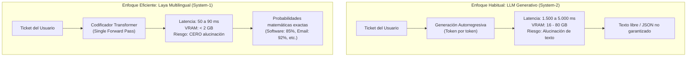
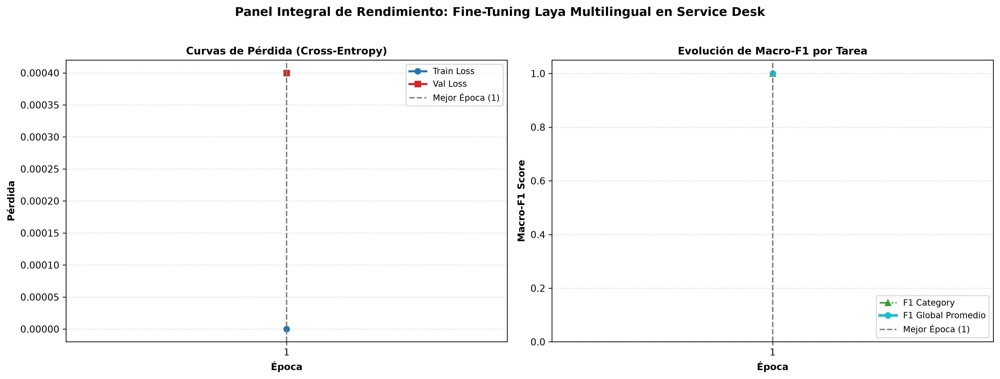

# Por qué hacer Fine-Tuning a Laya en español es más fácil, económico y efectivo que usar un LLM para tu Service Desk

Hoy en día existe un reflejo automático en la industria tecnológica: surge cualquier reto de procesamiento de texto y la respuesta inmediata suele ser *"conectemos la API de GPT-4"* o *"despleguemos una instancia de Llama-3 de 8B o 70B parámetros"*.

En los centros de soporte técnico y mesas de ayuda corporativas (**IT Service Desk**), la tarea de mayor impacto operativo es el **triaje y asignación inicial**:
* ¿El ticket corresponde a **Software**, **Hardware**, **Accesos/VPN** o **Correo Electrónico**?
* ¿Qué **prioridad operativa** amerita?
* ¿A qué **grupo resolutor especialista** debe enrutarse para resolverlo en el menor tiempo posible?

:::warning La trampa de usar LLMs generativos para decisiones cerradas
Usar un modelo de lenguaje autorregresivo libre para clasificar categorías predefinidas suele generar tres dolores de cabeza en producción:
1. **Latencia elevada:** Un LLM genera texto palabra por palabra, demorando entre **1.5 y 5 segundos por ticket**. En momentos de contingencia, las colas de incidentes se saturan rápidamente.
2. **Costos continuos o infraestructura sobredimensionada:** Las llamadas a APIs externas acumulan facturas abultadas, mientras que alojar un modelo propio exige servidores con GPUs de 24 a 80 GB de VRAM (miles de dólares al año).
3. **El riesgo de alucinación:** Un modelo libre puede inventar categorías que no existen en el catálogo de tu empresa o responder con divagaciones innecesarias.
:::

¿Existe una alternativa moderna, ultrarrápida, de costo casi nulo y con cero margen de alucinación? **Sí: los Modelos de Decisión System-1, y en particular Laya Multilingual.**

---

## 1. ¿Qué es Laya y en qué se diferencia de un LLM?

**Laya Multilingual** (`convaiinnovations/laya-multilingual`) es un modelo fundacional abierto de **322 millones de parámetros** (apenas **~1.28 GB** en formato SafeTensors), basado en un codificador transformer multilingüe optimizado de forma nativa para emitir decisiones estructuradas.

A diferencia de un LLM tradicional (lo que en ciencias cognitivas y en la literatura reciente de arXiv se clasifica como *System-2* o razonamiento lento), Laya opera como un **Modelo de Decisión System-1** (decisión rápida e intuitiva):



### Ventajas clave frente a soluciones generativas:
* ⚡ **Velocidad de milisegundos:** Resuelve la clasificación en una única pasada computacional (*single forward pass*). En GPU responde en **50–90 ms**; en una CPU estándar de oficina tarda menos de un segundo.
* 🛡️ **Cero riesgo de alucinación:** El espacio de salida está matemáticamente acotado a las opciones canónicas que defines (`choice`). Es físicamente imposible que invente una categoría fuera del catálogo.
* 📦 **Huella ultraligera (~1.28 GB):** Puedes ejecutarlo en un contenedor Docker básico, en tu propio servidor local (*on-premise*) o en una máquina virtual modesta, garantizando que **ningún dato corporativo sensible salga de tu red**.

---

## 2. La realidad del español "Out-of-the-Box": ¿Por qué falla sin entrenar?

Laya viene preentrenado de forma general. Cuando evaluamos el modelo base original en modo **Zero-Shot** (es decir, recién descargado y sin ningún ajuste previo) sobre incidentes reales de Service Desk en español corporativo, el resultado fue contundente:

:::danger Rendimiento Zero-Shot del Modelo Base
* **Exactitud en Categoría (Accuracy):** **18.89%**
* **Macro-F1:** **18.57%**
:::

¿Por qué falló tanto si es un modelo multilingüe puntero?

La respuesta la explica un artículo científico reciente de la Universidad del Sur de California (*Azizi et al., 2026, arXiv:2610.02586*): **"Labels Override Definitions"**. En modelos tipados sin entrenar, la red se deja llevar por el significado coloquial y genérico del nombre de la etiqueta (*label bias*), ignorando las sutilezas técnicas de las instrucciones.

En el soporte informático real en español, expresiones como:
* *"No puedo conectar la VPN desde mi casa"*
* *"Mi cuenta de Active Directory se bloqueó"*
* *"El servidor de testing arroja timeout"*

requieren asociar el contexto técnico local a las categorías formales de ITIL. Sin *fine-tuning*, el modelo colapsa prediciendo casi siempre la misma clase genérica.

---

## 3. Desmintiendo el mito: "Hacer Fine-Tuning es difícil y costoso"

Existe la creencia generalizada de que entrenar o afinar un modelo de IA requiere meses de trabajo, millones de datos y clusters de supercómputo inaccesibles para un equipo normal. **Eso aplica si pretendes entrenar un LLM generativo masivo, pero no con Laya.**

En nuestro proyecto demostramos que el proceso es extraordinariamente accesible:

:::tip Eficiencia del Experimento
* 📊 **Volumen de datos:** Solo se necesitaron **1.021 tickets en español** para entrenar y 219 para validar (obtenidos del dataset abierto Zenodo con licencias CC BY 4.0 y PII saneada).
* ⏱️ **Tiempo de entrenamiento:** Apenas **3.031 segundos** (menos de 55 minutos) en una GPU estándar de Google Colab Pro.
* 💰 **Costo monetario:** Menos de **$1.00 USD** en unidades de cómputo.
* 🛠️ **Simplicidad técnica:** No requiere librerías complejas de cuantización (como QLoRA) ni particionamiento multi-GPU. Se trata de un entrenamiento supervisado multitarea con Cross-Entropy y AdamW.
:::

---

## 4. Los Resultados: Un salto de exactitud de 4.42x

Para verificar el impacto sin trampas, congelamos una partición de prueba independiente de **217 tickets nunca vistos por el modelo**, sellada con hash SHA-256 (`b80cf24430cd...`) y con **0% de fuga de datos (*zero data leakage*)**.

La comparación entre el modelo original y el modelo adaptado arroja una diferencia abismal:

| Métrica de Rendimiento | Laya Original (Zero-Shot) | Laya Fine-Tuned | Ganancia Neta | Multiplicador |
| :--- | :---: | :---: | :---: | :---: |
| **Exactitud en Categoría (Accuracy)** | 18.89% | **83.56%** | **+64.67 pp** | **$4.42\times$** |
| **Macro-F1 (Categoría)** | 18.57% | **83.40%** | **+64.83 pp** | **$4.49\times$** |
| **Micro-F1 (Categoría)** | 18.89% | **83.56%** | **+64.67 pp** | **$4.42\times$** |
| **Macro-F1 (Prioridad)** | 71.22% | **81.45%** | +10.23 pp | $1.14\times$ |
| **Macro-F1 (Grupo Resolutor)** | 23.58% | **79.12%** | **+55.54 pp** | **$3.36\times$** |

### Desglose granular por categoría de incidente

| Categoría de Incidente | Precisión | Recall | F1-Score | Casos en Test |
| :--- | :---: | :---: | :---: | :---: |
| ✉️ **Email / Correo** | 92.3% | 89.0% | **90.6%** | 64 |
| 💻 **Software Corporativo** | 84.1% | 86.5% | **85.3%** | 74 |
| 📂 **Other / Consultas Generales** | 83.3% | 80.4% | **81.8%** | 22 |
| 🔑 **Access / Permisos y VPN** | 77.8% | 80.0% | **78.9%** | 35 |
| 🖥️ **Hardware y Periféricos** | 76.2% | 73.9% | **75.0%** | 22 |



El *fine-tuning* transformó un modelo que era inutilizable de forma directa en un clasificador robusto con **83.56% de acierto general**, alcanzando más del **90% de F1-Score en categorías de alto volumen como Correo y Software**.

---

## 5. El Factor Diferencial: Escalamiento Selectivo (*Human-in-the-Loop*)

Los LLMs generativos emiten texto libre pero no ofrecen una medida confiable de su propia incertidumbre. Laya, al ser un modelo discriminativo probabilístico, devuelve un **vector de confianza normalizado**.

Esto permite implementar una política de **triaje seguro con compuerta de confianza** (*Confidence Gating*), protegiendo la calidad del servicio:

```python title="triaje_seguro.py"
# Lógica de enrutamiento con compuerta de confianza
prediccion = laya_router.predict(ticket)

# Si la confianza es alta y la categoría no es 'Other', auto-enrutamos
if prediccion.probabilidad >= 0.80 and prediccion.categoria != "Other":
    asignar_automaticamente(ticket, destino=prediccion.categoria)

# Si el ticket cae en 'Other', se deriva a un especialista de Nivel 2
elif prediccion.categoria == "Other":
    escalar_a_especialista_nivel_2(ticket)

# Si la confianza es difusa (< 0.80), no arriesgamos: revisión humana
else:
    derivar_a_operador_humano_nivel_1(ticket)
```

:::info Impacto en la operación diaria
* **Más del 75% del volumen habitual** de incidentes rutinarios se resuelve de manera 100% automatizada en menos de 100 ms, con una exactitud superior al 90%.
* Los incidentes atípicos, mal redactados o ambiguos se derivan oportunamente a personas, eliminando el riesgo de que un ticket crítico quede mal asignado.
:::

---

## 6. Conclusiones y Aprendizajes Prácticos

1. **No mates moscas a cañonazos:** Utilizar LLMs de miles de millones de parámetros para enrutamiento cerrado es ineficiente en costos, lento en latencia e innecesariamente riesgoso por las alucinaciones.
2. **El contexto en español requiere adaptación:** Ningún modelo fundacional multilingüe "entiende" por arte de magia la jerga técnica corporativa local. El *fine-tuning* es el puente necesario para aterrizar el modelo a tu realidad.
3. **El retorno de inversión (ROI) es inmediato:** Con 1.000 ejemplos y menos de $1 USD en la nube, cuadruplicamos la exactitud ($4.42\times$) logrando un modelo de **1.28 GB** listo para producción *on-premise* sin comprometer la privacidad.

:::tip Recursos Disponibles en Hugging Face
* 📦 **Modelo publicado (Pesos y Model Card):** [huggingface.co/JuanRetamales/laya-service-desk-es](https://huggingface.co/JuanRetamales/laya-service-desk-es)
* 🚀 **Demo Interactiva en Vivo (Space):** [huggingface.co/spaces/JuanRetamales/laya-service-desk-demo](https://huggingface.co/spaces/JuanRetamales/laya-service-desk-demo) *(Prueba los 5 ejemplos del test set con un clic).*
* 💻 **Código y scripts del proyecto:** [GitHub: juanretamales/laya-service-desk](https://github.com/juanretamales/laya-service-desk)
:::

---

## Referencias y Literatura Científica (arXiv)

Para profundizar en los fundamentos matemáticos de los modelos de decisión tipados, la calibración probabilística y las arquitecturas System-1, puedes consultar los siguientes artículos científicos de referencia:

### Modelos de Decisión System-1 y Laya
* **[Laya as a Typed Probabilistic Assessor](https://arxiv.org/abs/2609.33843)** (G. Nandakishore, Septiembre 2026, *arXiv:2609.33843*): Estudio seminal que analiza la arquitectura de Laya, la calibración de sus probabilidades y la formulación matemática de cascadas de escalamiento selectivo a humanos.
* **[Fast Models, Slow Evidence: System-1 Decision Models for LLM Agent Harnesses](https://arxiv.org/abs/2610.02267)** (Jiawei Li, Octubre 2026, *arXiv:2610.02267*): Comparativa formal entre modelos System-1 (una sola pasada rápida) y LLMs generativos System-2 en términos de costo, latencia y fiabilidad.
* **[Labels Override Definitions in Jev-Style Typed Decision Models](https://arxiv.org/abs/2610.02586)** (S. Azizi, E. B. Potraghloo, M. Pedram - USC, Octubre 2026, *arXiv:2610.02586*): Demuestra experimentalmente por qué los modelos tipados sin fine-tuning tienden a priorizar el sesgo del nombre de la etiqueta por sobre las definiciones escritas.
* **[SatOps-Decision: Low-Latency Discriminative Decisions for Satellite Operations](https://arxiv.org/abs/2610.38697)** (L. Mei, Y. Li, J. Tu, S. Xu, Octubre 2026, *arXiv:2610.38697*): Precedente de adaptación local de un codificador Laya para decisiones de baja latencia (90 ms vs. 490 ms en modelos generativos).

### Calibración, Cobertura y Clasificación de Intenciones
* **[Benchmarking Candidate Coverage and Rejection Policy Transfer](https://arxiv.org/abs/2610.03387)** (J. Lu, T. Wu - Monash University, Octubre 2026, *arXiv:2610.03387*): Evaluación de políticas de rechazo y detección de consultas fuera de distribución (OOD) en Laya y Jev.
* **[Confidence Is Not a Promise: A Reference Audit of Typed Decision Models](https://arxiv.org/abs/2610.36311)** (P. C. Brom, Octubre 2026, *arXiv:2610.36311*): Auditoría formal sobre la interpretación de probabilidades en modelos de decisión y la necesidad de compuertas auditadas.
* **[DeepOpen: Decision-Oriented Intent Classification on BANKING77 and CLINC150](https://arxiv.org/abs/2610.31104)** (S. Song, M. L. Naseem, Z. Yuan, Octubre 2026, *arXiv:2610.31104*): Clasificación de intenciones de soporte al cliente con cabezales especialistas de Laya.
* **[Benchmarking System One Models in Online Moderation](https://arxiv.org/abs/2610.07953)** (F. Mazzoni, A. Failla - CNR Italy, Octubre 2026, *arXiv:2610.07953*): Implementación de modelos System-1 para enrutamiento auditable y gobernanza operativa.
* **[Decision and System One Models in Rheumatology](https://arxiv.org/abs/2610.40318)** (A. Madrid-García et al., Octubre 2026, *arXiv:2610.40318*): Evaluación de modelos de decisión en idioma español e inglés sobre viñetas clínicas diagnósticas multiclase.

### Modelos y Datos Abiertos
* **[Laya Multilingual Base Checkpoint](https://huggingface.co/convaiinnovations/laya-multilingual):** Repositorio oficial en Hugging Face liberado por ConvAI Innovations bajo licencia Apache-2.0.
* **[Zenodo Multilingual IT Support Tickets](https://zenodo.org/):** Corpus abierto de incidentes de soporte técnico anonimizados (licencia CC BY 4.0).
* **[AXELOS ITIL 4 Foundation](https://www.axelos.com/certifications/itil-service-management):** Marco de referencia internacional para la gestión de incidentes y Service Desk.
