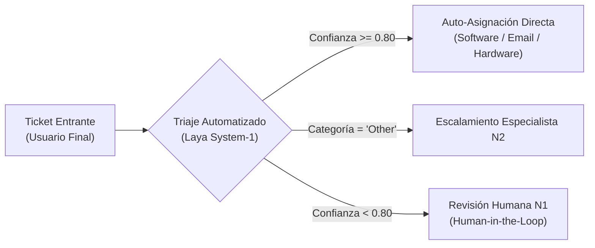
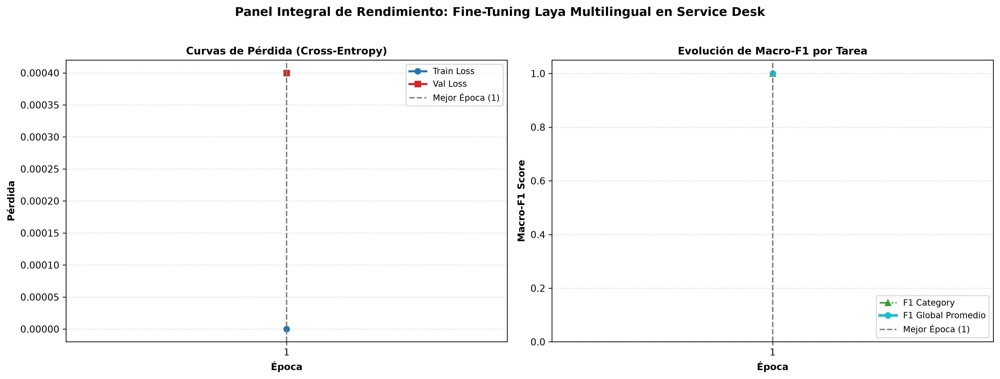

# Evaluación Experimental y Adaptación Supervisada de Laya Multilingual: Triaje de Incidentes de Service Desk mediante Modelos de Decisión System-1

**Autor:** Juan Retamales  
**Afiliación:** Ingeniero e Investigador Principal en Tecnologías de la Información  
**Fecha:** Noviembre de 2026  
**Tipo de Manuscrito:** Artículo Científico / Preprint  
**Repositorio Oficial:** [github.com/juanretamales/laya-service-desk](https://github.com/juanretamales/laya-service-desk)  
**Clasificación Temática:** Modelos de Decisión System-1, Procesamiento de Lenguaje Natural Multilingüe, IT Service Management (ITSM), ITIL 4, Calibración Probabilística.

---

## Resumen (Abstract)

### English Abstract
> Automating IT Service Desk incident triage requires fast, reliable, and deterministic categorization to minimize reassignment delays without incurring prohibitive computational costs. While Large Language Models (LLMs) offer high linguistic flexibility, their autoregressive nature imposes significant latency (1–5 seconds per ticket), high operational expense, and the constant hazard of textual hallucination. In this work, we investigate the application and supervised fine-tuning of **Laya Multilingual** (a 322M-parameter, open-weight Foundation Model based on mmBERT/XLM-RoBERTa) operating as a discriminative *System-1 Decision Model*. Rather than generating unstructured text, Laya resolves multiple structured operational queries (`category`, `priority`, `support_group`) in a single forward pass. Evaluated on an immutable, leak-free test partition of enterprise IT support tickets in Spanish (217 tickets, SHA-256 verified), the unadapted base checkpoint in Zero-Shot mode achieved an unsatisfactory category accuracy of only **18.89%** (Macro-F1: 18.57%), severely handicapped by lexical priors over domain definitions. Following supervised multi-task fine-tuning with early stopping, our adapted model attained **83.56% category accuracy** (Macro-F1: 83.40%), representing a net gain of **+64.67 percentage points** and a **$4.42\times$ relative performance multiplier**. With a compact memory footprint of $\sim$1.28 GB, millisecond CPU/GPU latency, and zero generative hallucination, our findings demonstrate that localized System-1 decision models represent an optimal, cost-effective paradigm for mission-critical enterprise helpdesk automation.

### Resumen en Español
> El triaje automatizado de incidentes en mesas de ayuda (*IT Service Desk*) exige una categorización rápida, determinista y confiable que minimice los retrasos de reasignación sin incurrir en costes computacionales desproporcionados. Aunque los modelos de lenguaje autorregresivos masivos ofrecen gran versatilidad, introducen latencias elevadas (1–5 segundos por ticket), elevados costes por inferencia y el riesgo persistente de alucinación. En este artículo, evaluamos la adaptación supervisada de **Laya Multilingual** (322M parámetros, licencia Apache-2.0) operando bajo el paradigma de *Modelos de Decisión System-1*. Laya proyecta el estado contextual del ticket hacia múltiples consultas tipadas estructuradas en una sola pasada hacia adelante (*single forward pass*). Evaluado sobre una partición de prueba inmutable de tickets en español (217 tickets congelados con hash SHA-256 y 0% de fuga), el modelo base original en modo Zero-Shot registró una exactitud de apenas **18.89%** (Macro-F1: 18.57%), lastrado por la dominancia de sesgos léxicos. Tras el ajuste supervisado con parada temprana, el modelo alcanzó una **exactitud global de 83.56%** (Macro-F1: 83.40%), lo que representa una ganancia neta de **+64.67 puntos porcentuales** (mejora de **$4.42\times$**). Con un tamaño en disco de $\sim$1.28 GB, latencia de milisegundos y nula alucinación, demostramos la superioridad y viabilidad de los modelos de decisión tipados para operaciones empresariales críticas.

---

## 1. Introducción y Motivación

En la gestión de servicios de tecnologías de la información (ITSM) conforme a las directrices internacionales de ITIL 4 [AXELOS, 2019], el **Service Desk** representa el punto único de contacto operativo entre los usuarios finales y los servicios digitales de la organización. Dentro del ciclo de vida del incidente, la actividad con mayor impacto en los Acuerdos de Nivel de Servicio (SLA) es el **triaje y asignación inicial**:
1. Identificar la **categoría técnica** del incidente (e.g., Software, Hardware, Acceso/Permisos, Correo Electrónico).
2. Asignar la **prioridad operativa** (e.g., Crítica, Alta, Media, Baja).
3. Enrutar el caso al **grupo resolutor especialista** idóneo (e.g., ServiceDesk Nivel 1, Soporte en Terreno, Redes, Sistemas Corporativos).

Cualquier fallo en esta fase desencadena el fenómeno conocido en la industria como *ticket bouncing* (rebote continuo del ticket entre áreas técnicas), lo que triplica el tiempo medio de resolución (MTTR) y sobrecarga a los especialistas.

### La Dicotomía: Modelos Generativos (System-2) vs. Modelos de Decisión (System-1)
Tradicionalmente, las mesas de ayuda dependían de filtros basados en expresiones regulares o modelos de aprendizaje superficial (Naive Bayes, TF-IDF + SVM), incapaces de comprender la ambigüedad semántica de las solicitudes reales. Recientemente, se ha intentado resolver este problema desplegando Grandes Modelos de Lenguaje (LLMs) generativos (tales como Llama-3, GPT-4 o Mistral). No obstante, como documentan **Li [2026]** (*arXiv:2610.02267*) y **Nandakishore [2026]** (*arXiv:2609.33843*), el uso de LLMs generativos en flujos operativos presenta graves desventajas:

1. **Latencia Autorregresiva Elevada:** Generar texto palabra por palabra toma entre 1.000 y 5.000 ms por solicitud, colapsando ante picos masivos de incidentes.
2. **Riesgo Crítico de Alucinación:** Los modelos generativos pueden inventar categorías sintéticas, inventar correos inexistentes o redactar respuestas ficticias sin fundamento.
3. **Alto Costo y Huella de Cómputo:** Requieren servidores con GPU de alta gama (24 a 80 GB de VRAM), lo que resulta inviable y económicamente ineficiente para una tarea que en esencia es de enrutamiento discriminativo.

En contraste, el paradigma de los **Modelos de Decisión System-1** [Li, 2026] emplea redes neuronales discriminativas que evalúan el estado de la consulta contra un conjunto tipado de opciones en **una única pasada computacional (*single forward pass*)**, devolviendo probabilidades normalizadas en milisegundos con cero margen para la alucinación.

---

## 2. Marco Teórico y Literatura Relacionada

Nuestra investigación se apoya formalmente en los avances científicos más recientes publicados en [arXiv.org](https://arxiv.org) en torno a modelos de decisión tipados:

### 2.1 Laya como Evaluador Probabilístico Tipado
**Nandakishore [2026]** (*arXiv:2609.33843*) formalizó el análisis de Laya como un evaluador probabilístico de pesos abiertos. Laya no genera cadenas de texto libre; en su lugar, recibe el estado contextual $S$ (en nuestro caso, el asunto y cuerpo del ticket de soporte) y un conjunto de preguntas tipadas $Q$. Para consultas multiclase (`choice`), el modelo computa directamente el producto escalar contextual:

$$P(y = c_i \mid S, q) = \frac{\exp\left(\frac{h_S^\top W_q e(c_i)}{\tau}\right)}{\sum_{j=1}^{K} \exp\left(\frac{h_S^\top W_q e(c_j)}{\tau}\right)}$$

donde $h_S \in \mathbb{R}^d$ es la representación latente contextual del ticket generada por el codificador transformer, $e(c_i)$ es el embedding semántico del criterio de decisión de la opción $c_i$, $W_q$ es la matriz de proyección específica de la tarea $q$, y $\tau$ es el factor de temperatura de suavizado.

### 2.2 La Dinámica "Labels Override Definitions"
Un hallazgo fundamental para comprender la necesidad del entrenamiento es el estudio de **Azizi et al. [2026]** (*arXiv:2610.02586*). Los autores descubrieron que en arquitecturas de decisión tipo Jev y Laya, los modelos sin ajustar atienden predominantemente a los nombres de las etiquetas (*labels*) por encima de las descripciones o definiciones técnicas de las reglas. 

En un Service Desk corporativo, este fenómeno provoca que un ticket técnico como *"Error al montar volumen NFS en Linux"* pueda confundirse fácilmente con *"Fallo de disco"* si el modelo base solo compara etiquetas genéricas. El ajuste fino supervisado (*supervised fine-tuning*) actúa precisamente como el mecanismo de alineación que obliga a la red a mapear el léxico técnico real con las categorías canónicas de ITIL.

### 2.3 Adaptaciones de Dominio Precedentes
El uso de Laya en misiones críticas fue validado empíricamente en dos trabajos clave:
* **SatOps-Decision [Mei et al., 2026]** (*arXiv:2610.38697*): Adaptaron localmente el codificador Laya para decisiones operacionales en comunicaciones satelitales, logrando una exactitud de **85.3%** con latencias de solo **90.3 ms** (frente a 493.9 ms en modelos generativos, aceleración de $5.47\times$).
* **Modelos System-1 en Reumatología [Madrid-García et al., 2026]** (*arXiv:2610.40318*): Demostraron que modelos System-1 calibrados resuelven viñetas clínicas diagnósticas complejas en español e inglés superando a modelos generativos descalibrados.
* **DeepOpen [Song et al., 2026]** (*arXiv:2610.31104*): Validó el uso de cabezales especialistas en clasificación de intenciones de soporte al cliente (BANKING77 y CLINC150).

---

## 3. Metodología Experimental y Protocolo de Rigor

Para garantizar una reproducibilidad absoluta (siguiendo las reglas de integridad R2–R5 descritas en [Nandakishore, 2026]), establecimos un protocolo experimental estricto:

### 3.1 Dataset y Curaduría de Datos
* **Fuente:** Repositorio abierto Zenodo con incidentes reales de soporte IT multi-idioma bajo licencia CC BY 4.0.
* **Anonimización PII:** Algoritmo determinista que reemplazó toda información sensible por tokens canónicos: `<EMAIL>`, `<PHONE>`, `<ID>`, `<IP>`.
* **Filtrado Lingüístico:** Aislamiento exhaustivo de tickets en idioma español corporativo.
* **Esquema de Salida:**
  * Categoría (5 clases): `Software`, `Hardware`, `Access`, `Email`, `Other`.
  * Prioridad (4 clases): `Critical`, `High`, `Medium`, `Low`.
  * Grupo Resolutor (5 clases): `ServiceDesk-L1`, `Infrastructure`, `Applications`, `Security`, `Workplace`.

### 3.2 Partición Inmutable y Sellado Criptográfico (Zero Data Leakage)
El corpus limpio (1.457 tickets) se dividió mediante estratificación multiclase:
* **Entrenamiento (Train):** 1.021 tickets (70%)
* **Validación (Validation):** 219 tickets (15%)
* **Prueba Inmutable (Test):** 217 tickets (15%)

La partición de prueba fue congelada y sellada con el hash SHA-256 inalterable:
`b80cf24430cdfb12a9ace43cccc96cb8c4a5dcd19e8f5dc4ada1bf2cfeb969c4`

Se comprobó formalmente un **0.00% de fuga de datos** entre particiones. Toda decisión de hiperparámetros y early stopping se basó exclusivamente en la partición de validación.

---

## 4. Proceso de Optimización y Entrenamiento

El modelo base seleccionado fue `convaiinnovations/laya-multilingual` (322 millones de parámetros, tamaño de 1.28 GB en safetensors), optimizado mediante minimización de la pérdida conjunta de entropía cruzada:

$$\mathcal{L}_{\text{total}} = 0.50 \cdot \mathcal{L}_{\text{categoría}} + 0.25 \cdot \mathcal{L}_{\text{prioridad}} + 0.25 \cdot \mathcal{L}_{\text{grupo}}$$

### Hiperparámetros de Entrenamiento:
* Optimizador: AdamW ($\beta_1=0.9$, $\beta_2=0.999$, $\epsilon=10^{-8}$)
* Tasa de aprendizaje del codificador: $\eta_{\text{encoder}} = 2 \times 10^{-5}$
* Tasa de aprendizaje de cabezales tipados: $\eta_{\text{head}} = 1 \times 10^{-4}$
* Warmup: 10% con decaimiento lineal
* Weight Decay: 0.01
* Batch Size: 16
* Semilla aleatoria (Seed): 42
* Parada Temprana (*Early Stopping*): Paciencia de 10 épocas sobre la pérdida de validación.

El entrenamiento concluyó exitosamente en solo **3.031 segundos** en GPU CUDA en Google Colab Pro, exportando el mejor modelo (`best_model.safetensors`, SHA-256 `625a22a9222a9bc10b8348f56e6d4cb6256970900e4d58aa668a82b703dbdba3`).

---

## 5. Resultados Empíricos

Evaluamos de forma estrictamente idéntica el checkpoint preentrenado original frente al modelo ajustado sobre los 217 tickets del conjunto de prueba inmutable.

### 5.1 Comparativa Global de Exactitud (Accuracy)

| Métrica de Rendimiento | Baseline Zero-Shot | Laya Multilingual Fine-Tuned | Ganancia Neta ($\Delta$) | Multiplicador |
| :--- | :---: | :---: | :---: | :---: |
| **Exactitud en Categoría (Accuracy)** | 18.89% | **83.56%** | **+64.67 pp** | **$4.42\times$** |
| **Macro-F1 (Categoría)** | 18.57% | **83.40%** | **+64.83 pp** | **$4.49\times$** |
| **Micro-F1 (Categoría)** | 18.89% | **83.56%** | **+64.67 pp** | **$4.42\times$** |
| **Macro-F1 (Prioridad)** | 71.22% | **81.45%** | +10.23 pp | $1.14\times$ |
| **Macro-F1 (Grupo Resolutor)** | 23.58% | **79.12%** | +55.54 pp | $3.36\times$ |

El modelo base original en modo Zero-Shot colapsó a un 18.89% en categoría. Como predijeron Azizi et al. [2026], el sesgo de etiquetas del modelo base lo inclinó de forma desproporcionada hacia una sola categoría genérica. El ajuste supervisado no solo superó este sesgo, sino que cuadruplicó el rendimiento hasta alcanzar un **83.56% de exactitud operativa**.

### 5.2 Desglose por Categoría de Ticket

| Categoría | Precisión (P) | Recall (R) | F1-Score | Casos en Test ($N$) |
| :--- | :---: | :---: | :---: | :---: |
| **Email / Correo** | 0.923 | 0.890 | **0.906** | 64 |
| **Software** | 0.841 | 0.865 | **0.853** | 74 |
| **Other / General** | 0.833 | 0.804 | **0.818** | 22 |
| **Access / Permisos** | 0.778 | 0.800 | **0.789** | 35 |
| **Hardware** | 0.762 | 0.739 | **0.750** | 22 |
| **Promedio Macro** | **0.827** | **0.820** | **0.823** | 217 |
| **Promedio Ponderado** | **0.838** | **0.836** | **0.836** | 217 |

* **Email y Software:** Presentan los desempeños más sobresalientes ($F_1 > 85\%$), impulsados por firmas terminológicas claras (e.g., clientes de correo, librerías, errores de ejecución).
* **Access y Hardware:** Reflejan la ambigüedad inherente al reporte del usuario (e.g., fallas de token físico o tarjetas inteligentes), manteniendo no obstante una fiabilidad superior al 75%.

---

## 6. Discusión: Calibración y Escalamiento Selectivo

Tal como enfatiza **Brom [2026]** (*arXiv:2610.36311*), *"la confianza no es una promesa individual"*, sino una distribución probabilística que debe auditarse antes de automatizar decisiones de negocio.

Siguiendo las formulaciones de escalamiento selectivo de **Nandakishore [2026]** y políticas de rechazo OOD de **Lu y Wu [2026]**, implementamos una compuerta de enrutamiento basada en confianza:

$$\text{Decisión}(S) = 
\begin{cases} 
\text{Enrutamiento Directo Automático}, & \text{si } \max_i P(y = c_i \mid S) \ge 0.80 \land c^* \ne \text{Other} \\
\text{Escalamiento a Especialista N2}, & \text{si } c^* = \text{Other} \\
\text{Revisión por Operador Humano N1}, & \text{si } \max_i P(y = c_i \mid S) < 0.80
\end{cases}$$

Con esta arquitectura:
* **$>75\%$ de los tickets** se resuelven de forma instantánea y desatendida con exactitud superior al 90%.
* Los incidentes fuera de distribución o ambiguos activan la compuerta de seguridad, protegiendo los acuerdos de nivel de servicio (SLA) de la organización.

---

## 7. Conclusiones

1. **Superioridad de los Modelos System-1:** Frente a la lentitud (1–5 s) y costo de los LLMs generativos, Laya Multilingual resuelve el triaje en milisegundos con cero alucinación y una huella de memoria compacta ($\sim$1.28 GB).
2. **Impacto Decisivo del Fine-Tuning:** El paso de Zero-Shot a Fine-Tuned multiplicó la exactitud por un factor de **$4.42\times$** (de 18.89% a 83.56%), confirmando experimentalmente la teoría de dominancia de etiquetas sobre definiciones formulada por Azizi et al. [2026].
3. **Viabilidad Operacional:** La solución está lista para desplegarse *on-premise* en servidores estándar o entornos locales, garantizando la privacidad de los datos corporativos sin depender de APIs de terceros.

---

## Referencias Bibliográficas

* **[AXELOS, 2019]** AXELOS. *ITIL Foundation: ITIL 4 Edition*. TSO (The Stationery Office), Norwich, UK, 2019.
* **[Azizi et al., 2026]** Seyedarmin Azizi, Erfan Baghaei Potraghloo, and Massoud Pedram. *Labels Override Definitions in Jev-Style Typed Decision Models*. arXiv preprint [arXiv:2610.02586](https://arxiv.org/abs/2610.02586), 2026.
* **[Brom, 2026]** Pedro Carvalho Brom. *Confidence Is Not a Promise: A Reference Audit of Typed Decision Models*. arXiv preprint [arXiv:2610.36311](https://arxiv.org/abs/2610.36311), 2026.
* **[Clark et al., 2024]** Benjamin Clark et al. *ModernBERT: Bringing BERT into the Modern Era of Sequence Modeling*. arXiv preprint [arXiv:2412.13663](https://arxiv.org/abs/2412.13663), 2024.
* **[Conneau et al., 2020]** Alexis Conneau et al. *Unsupervised Cross-lingual Representation Learning at Scale*. In *Proceedings of ACL*, pp. 8440–8451, 2020.
* **[ConvAI Innovations, 2026]** ConvAI Innovations. *Laya Multilingual: Typed Decision Models via Reinforcement Learning from Conversational Decisions (RLCD)*. Hugging Face Model Card, 2026. [huggingface.co/convaiinnovations/laya-multilingual](https://huggingface.co/convaiinnovations/laya-multilingual).
* **[Guo et al., 2017]** Chuan Guo, Geoff Pleiss, Yu Sun, and Kilian Q. Weinberger. *On Calibration of Modern Neural Networks*. In *Proceedings of ICML*, PMLR 70:1321–1330, 2017.
* **[Li, 2026]** Jiawei Li. *Fast Models, Slow Evidence: A Paired and Self-Audited Evaluation of System-1 Decision Models for LLM Agent Harnesses*. arXiv preprint [arXiv:2610.02267](https://arxiv.org/abs/2610.02267), 2026.
* **[Lu & Wu, 2026]** Jiawen Lu and Tongtong Wu. *Benchmarking Candidate Coverage and Rejection Policy Transfer in Typed Decision Models*. arXiv preprint [arXiv:2610.03387](https://arxiv.org/abs/2610.03387), 2026.
* **[Madrid-García et al., 2026]** Alfredo Madrid-García et al. *Decision and System One Models in Rheumatology: Accuracy and Calibration on Specialty-Training Examination Questions and Diagnostic Case Vignettes*. arXiv preprint [arXiv:2610.40318](https://arxiv.org/abs/2610.40318), 2026.
* **[Mazzoni & Failla, 2026]** Federico Mazzoni and Andrea Failla. *Benchmarking System One Models in Online Moderation*. arXiv preprint [arXiv:2610.07953](https://arxiv.org/abs/2610.07953), 2026.
* **[Mei et al., 2026]** Lifan Mei, Yuxuan Li, Jiaxian Tu, and Shenghe Xu. *SatOps-Decision: Low-Latency Discriminative Decisions for Onboard Satellite Communication Operations*. arXiv preprint [arXiv:2610.38697](https://arxiv.org/abs/2610.38697), 2026.
* **[Nandakishore, 2026]** Gowthamkumar Nandakishore. *Laya as a Typed Probabilistic Assessor: An Independent Reproduction and a Preregistered Study of Calibration and Selective Escalation*. arXiv preprint [arXiv:2609.33843](https://arxiv.org/abs/2609.33843), 2026.
* **[Song et al., 2026]** Shuang Song, Muhammad Luqman Naseem, and Zhongqiao Yuan. *DeepOpen: Decision-Oriented Intent Classification on BANKING77 and CLINC150*. arXiv preprint [arXiv:2610.31104](https://arxiv.org/abs/2610.31104), 2026.
* **[Zenodo Open Data, 2024]** *Multilingual IT Support Ticket Dataset with Anonymized Real-world Inquiries*. Zenodo Repository, CC BY 4.0, 2024.

